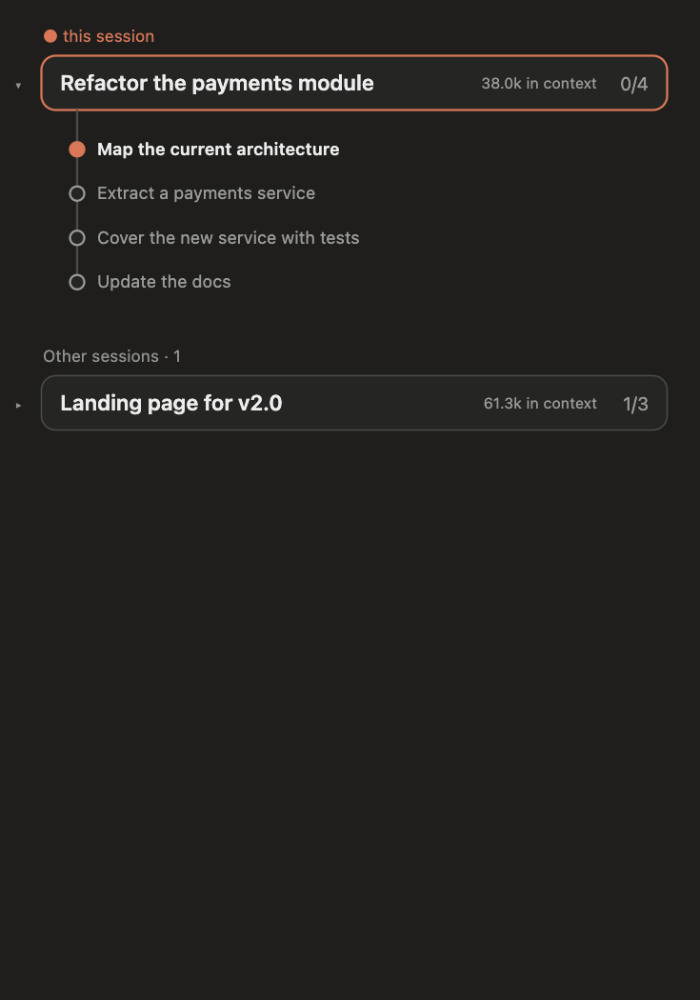
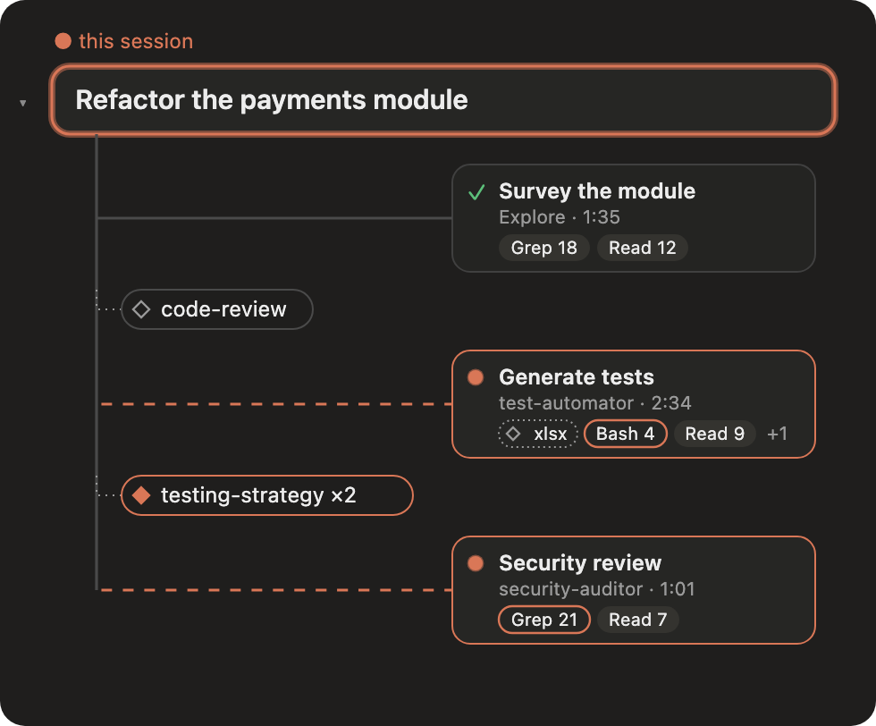
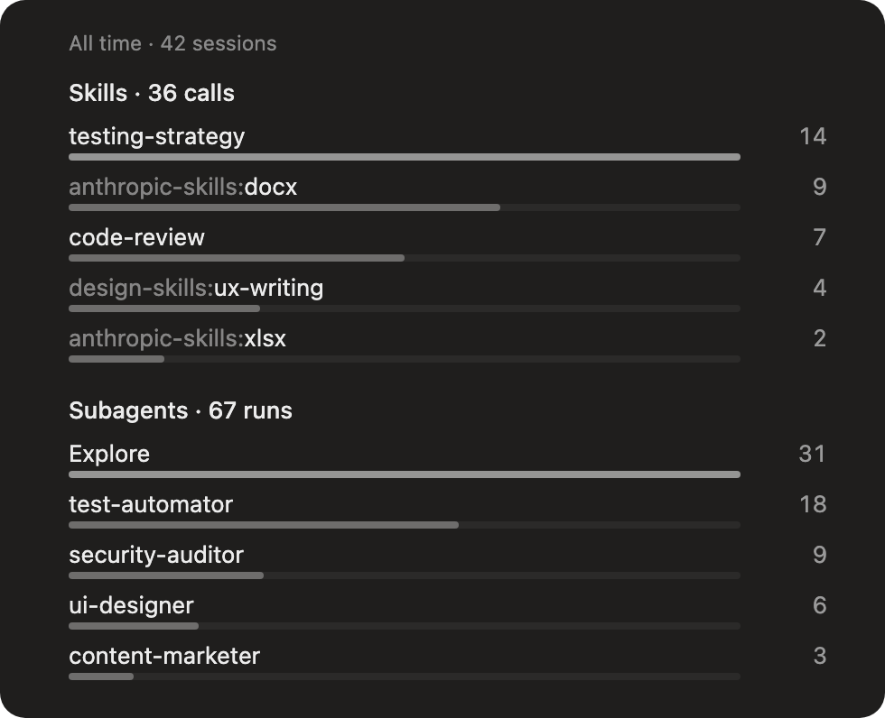

# Agents, skills & plans

**A live side pane for Claude Code that shows what your agents are doing** — the plan each session is working through, the subagents it spawned, the skills it called and the tools they use — across every open session, as a list or as a graph.

<p align="center">
  
</p>

## What you get

- **Every session in one place.** Each open Claude Code session publishes its state; the pane shows them all, with yours framed on top and the others below, each foldable.
- **Plans, live.** The step list Claude keeps for a task, with the current step pulsing. Replaced plans are kept under *Past plans*, dropped steps struck through.
- **Subagents where they belong.** Each subagent hangs off the plan step it was spawned under, with its status, running time and its busiest tools (`Grep 21`, `Read 7` …). The tool it is using right now is outlined.
- **Skills too.** Skills the conversation calls appear as pills under their step (◆ active, ◇ used, red on error, `×2` when repeated); skills a subagent calls sit on its card.
- **List or graph.** A compact list for narrow panes, or an animated graph: flowing edges to running agents, pulsing steps.
- **Token usage.** Each subagent shows the tokens it has used (`142.8k tokens`), and each session the tokens in its context window (`152.4k in context`). Turn it off under ⚙.
- **Codex and Gemini too.** When Claude (or one of its subagents) runs `codex` or `gemini` through Bash, the run gets a card of its own, with its model and tokens, and the agents *it* spawns hang under it, and theirs under them.
- **Who is working, who waits for you.** A session at work (a subagent running or a plan step in progress) has a glint travelling round its frame in the graph. A session waiting on you (a permission prompt, a question, or a turn that ended on a question) knocks twice and rests, in amber, and says `● waiting for you` in the list.
- **Filters.** `● Plans ● Agents ● Skills` — turn any of them off. With plans off the graph becomes a timeline.
- **All-time statistics.** Which skills and subagent types you use most, counted from every transcript on your machine.

<table>
  <tr>
    <td width="50%" valign="top"><br><sub>Plans filtered out: the trunk becomes a time axis.</sub></td>
    <td width="50%" valign="top"><br><sub>Statistics, opened from the bottom-right corner.</sub></td>
  </tr>
</table>

<sub>The animation and screenshots use made-up demo data.</sub>

## Install

At the prompt of a Claude Code terminal session:

```
/plugin install subagents-pane --marketplace qaokss/claude-agents-view
```

Answer `y` to add the marketplace, then pick a scope (user scope loads it in every session).

From a shell:

```bash
claude plugin install subagents-pane --marketplace qaokss/claude-agents-view
```

In the Claude desktop app, where `/plugin` does not run: click **+** next to the prompt box → **Plugins** → **Add marketplace** with `qaokss/claude-agents-view` → **Add plugin**.

The pane opens by itself when a session starts. If you close it, bring it back with:

```
/agents-view
```

(`/subagents` does the same.)

## Using it

| Control | Where | What it does |
| --- | --- | --- |
| `List │ Graph` | top right | Switches the view. The graph needs the desktop or mobile app; the terminal shows the list. |
| `⚙` | top right | Settings: `● Token usage` shows or hides token counts. |
| `● Plans ● Agents ● Skills` | under it | Shows or hides each kind, for all sessions at once. |
| `▸` / `▾` | left of a session | Folds what hangs off a session; its name stays. |
| `collapse all` | above other sessions | Folds or unfolds every other session. |
| `▸ Past plans`, `▸ Finished subagents`, `▸ Used skills` | inside a session | Earlier work, folded by default. In the graph, subagents that ran outside a plan step fold under `▸ Finished subagents` once you send the next message or a new plan starts. |
| `Statistics ▴` | bottom right | Opens the all-time ranking of skills and subagent types. |

Folds, the chosen view, filters and settings are remembered per session.

## How it works

It is a Claude Code **hooks module** (`hooks/register.tsx`) — no server, no network.

- **Plans** come from Claude's own task-list tool calls; **subagents** from `agent.spawn` and their turns; **skills** from `Skill` tool calls; **tool counts** from each subagent's tool calls.
- **Sharing between sessions:** every session writes a small JSON snapshot to `~/.claude/mods-data/subagents-pane/sessions/` once a second when something changes (and a heartbeat every 30 s). The pane reads the others' snapshots, listing sessions at work (a subagent running or a plan step in progress) first; a session that stops updating disappears after 90 s.
- **Tokens** come from the engine: a subagent's `tokenCount` in `$.agent.list()` (its latest request's input plus all its output, the figure Claude Code's own agent list shows), the session's from `$.session.usage()`.
- **Codex and Gemini runs** are Bash calls whose command starts `codex`, `gemini`, `npx @openai/codex` or `npx @google/gemini-cli`. Neither CLI reports to Claude Code, so the pane reads the session log each one keeps, only the new part (`tail -c +N`) every 3 s while the run lasts: Codex's `$CODEX_HOME/sessions/YYYY/MM/DD/rollout-*.jsonl` (`session_meta`, `token_count`, `task_complete`; a subagent's log names its parent thread) and Gemini's `~/.gemini/tmp/<project>/chats/session-*.jsonl` (per-message `tokens`; a subagent's chat sits in `chats/<parent session>/`). A run's log is the first one its CLI began, after the call, in the folder the command works in (`cd … &&`, Codex's `-C`). Tokens are counted as for Claude: the last request's input plus all output. A run in the foreground ends when its Bash call returns; in the background, at Codex's `task_complete`, or once a Gemini chat ends on the model's answer and stays still for 20 s.
- **Session names** are the chat titles Claude Code keeps next to each transcript (`custom-title.json`).
- **Statistics** scan your transcripts in `~/.claude/projects` with `grep` while the statistics card is open (every 30 s), counting each `Skill` and `Agent` call once.
- **Pictures** in graph view are SVGs drawn by `hooks/graph.ts`, animated with SMIL, sized to the pane.

Everything stays on your machine.

## Development

```bash
claude plugin validate .
claude plugin test .
```

Tests live in `tests/pane.test.tsx` and run the module against the engine with mocked clock, files and processes.

Built and tested with Claude Code 2.1.321–2.1.325. The hooks-module API is in early access and may change between releases.

## License

[MIT](LICENSE)
